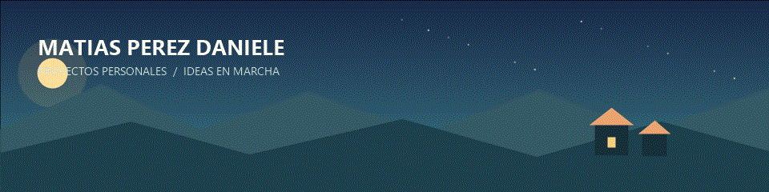

# Proyectos personales

¡Buenas! Soy **Matías Pérez Daniele**. Este repositorio es mi espacio para ir
subiendo proyectos que hago por mi cuenta, aprender cosas nuevas y probar ideas
que me dan curiosidad. Los voy construyendo de a poco y voy compartiendo el
proceso, no solo el resultado final.

## En qué estoy trabajando

### [Ecos del Valle](./EcosDelValle/)

Un juego de simulación 2D que estoy empezando a crear con Godot. La idea es
construir un pueblo con personajes que tengan rutinas, necesidades y recuerdos,
y ver cómo cambian sus decisiones cuando el jugador modifica el entorno.

Es un proyecto personal para aprender a hacer un juego desde cero: ahora mismo
estoy preparando la base y, paso a paso, voy a ir sumando el pueblo y sus
habitantes.

## Contacto

- **Email:** [Matiasperezdaniele@gmail.com](mailto:Matiasperezdaniele@gmail.com)

